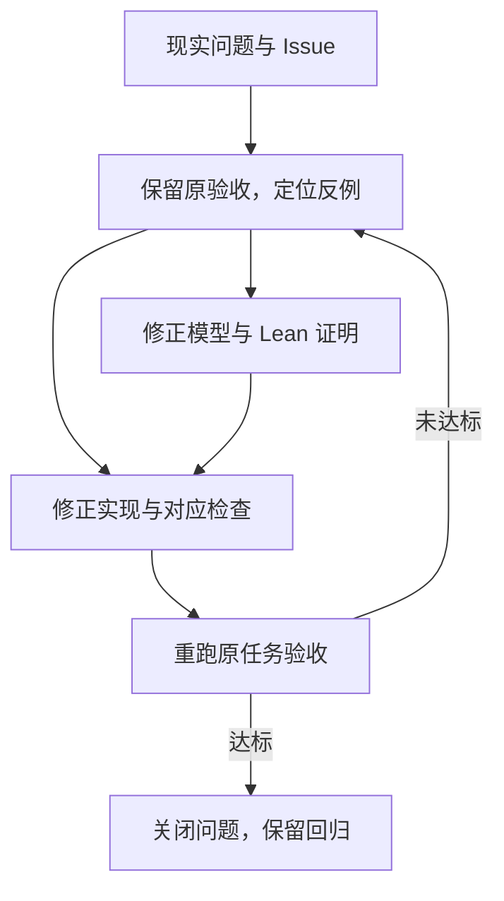

# 从现实反例到模型、代码与任务验收

**维护约定 · 2026-11-20**

现实任务中的失败、误判或新情境可以挑战原语的数学建模。处理目标是让原任务达标，并留下可复用的改进；模型、Lean 证明和实现对应关系都可以被修正。

新开发也主动采用[建模与证明驱动的开发原则](MODEL_GUIDED_DEVELOPMENT.md)，提前复用或补足关键模型，逐步积累证明；本页负责现实反例出现后的修订与验收闭环。

这里的模型正确性相对于明确的任务、环境、成本与验收要求。Lean 检查给定定义和前提下的推导；模型是否保留现实中关键的区别、前提能否落实，以及现实效果是否达标，分别提供证据。

## 用户只需提供三件事

1. 实际出现了什么？
2. 原本期待什么，怎样才算完成？
3. 有什么可查看的产物、输入、错误或复现材料？

可以直接在对话中描述，由接手的 Agent 建立或补充 Issue；也可以使用 [模型与实现挑战入口](https://github.com/mayf3/primitives/issues/new?template=model-challenge.yml)。不要求报告者先定位定理或写出数学反例。公开 Issue 只保留可公开的最小复现；真实个人记录和私有运行数据留在原系统，用有权限的引用连接。

## 处理闭环



### 1. 固定任务与失败版本

Agent 先保存原验收要求、不可接受结果、适用环境与成本约束，定位原语 ID、模型版本、实现仓库与提交、输入和观察条件。版本暂时不明时记录未知并继续查，不把未知补成事实。

同一挑战默认一个 Issue。只有确实跨仓、存在独立交付责任或纯模型子任务时才拆出关联项；原任务仍有一个可追踪的验收入口。

### 2. 判断问题落在哪一层

| 类别 | 要检查的问题 | 对应处理 |
|---|---|---|
| 模型遗漏 | 影响结果的身份、状态、时间、动作或关系是否被压掉？ | 扩展对象或关系，必要时拆分、合并或降级原语，再证明相关命题 |
| 前提失效 | 某项假设在实际系统中无法保证吗？ | 实现保障机制，或把不确定性纳入模型；说明新增前提怎样落实 |
| 实现不符 | 模型要求合理，但代码执行了不同的转移或观察？ | 修实现与绑定，保留模型也可能是正确选择 |
| 证据不足 | 只有成功标记、日志或代理指标，尚无真实效果证据？ | 补观察与验收，结果保持未知 |
| 验证入口错误 | 检查器、审计器或数据适配器漏查、误判？ | 修检查机制，并按影响范围重查旧结果 |
| 任务改变 | 新需求超出了原来约定的目标或环境？ | 明确新版本和新验收，保留原任务结果，不追改历史 |

一个问题可以涉及多层。不要求每个实现 bug 都修改数学模型。现实失败也未必反驳条件定理：它可能显示前提不成立、模型漏掉了状态，或代码没有执行模型所要求的行为。

### 3. 用反例修正模型

Agent 构造最小反例，记录旧模型或旧代码为什么接受、忽略或无法表达它。修订时保留原验收，不在模型中无依据排除现实仍允许的失败路径，不把目标改弱，也不增加现实无法提供的假设来换取证明通过。通过实现修改消除失败路径时，保留旧反例，并提供路径已被实际阻断的证据。

合理收缩模型范围可以做，但必须记录原案例仍未解决。若拟议变更超出该任务已有授权，涉及目标或重要代价取舍，交回用户决定；已有授权范围内的修复与实现选择由 Agent 继续推进。纯模型子项可以完成，原任务不能因此登记为完成。

模型改动须说明新增和移除的假设、受影响的命题与原语版本，保留非空正例和针对旧缺口的负例。若只能支持经验性或启发式结论，就明确降级主张；不把所有领域效果硬写成无根据的公理。

### 4. 建立模型与实现的具体对应

实现 PR 给出可查的对应表，至少包含：

| 模型责任 | 实现中要指出的东西 |
|---|---|
| 初始状态与不变量 | 实际初始化、持久字段及输入校验 |
| 动作与允许转移 | 具体函数、分支、状态更新及异常路径 |
| 观察与证据 | 返回值、事件或数据读取的位置、身份和版本绑定 |
| 执行顺序与进展 | 同步、重试、恢复、终止；相关环境条件 |
| 模型验收与原任务验收 | 实际产物或外部结果如何证明原要求满足 |

形式化的实现对应可以使用关系 `R(concrete, model)`，证明初态对应、具体步骤由抽象步骤或有限步执行覆盖，并把模型验收连接回原任务验收。允许停顿的安全模拟本身不保证终止；无限停顿、调度公平或外部响应仍需单独处理。

只做轨迹回放、性质测试、有限枚举或故障注入时，明确写成相应测试证据。它们不能登记为整段 Python/TypeScript 程序的全量形式精化证明。可计算的小核心可以逐步使用经过证明的实现，再明确核对调用、解析与 I/O 边界。

此处借用形式化方法中的实现精化思路；[Abadi 与 Lamport 的原始说明](https://www.microsoft.com/en-us/research/publication/the-existence-of-refinement-mappings/)解释了低层行为与高层规范的对应。本仓库的具体实现仍需自己提交证据。

### 5. 用原任务验收闭环

先重放原反例，再检查非空正常实例和受影响的回归；最后在该任务约定的真实输入、代码版本和运行环境下检查原验收。需要观看、试听、实际操作或真人判断的效果，保留相应观察，不能由编译、截图存在或 Agent 自报替代。

新增的前提必须有实现或环境保证。例如“每个返回都符合模型”是执行器应履行的责任；把合同写强本身不会改变执行器。

## 同一 Issue 中的三项证据状态

Agent 在完成初次定位后补充以下记录。每项使用“未开展 / 进行中 / 已验证”，并写证据类型；确实不适用时写明理由。

| 项目 | 何时可记录为已验证 |
|---|---|
| 模型与证明 | 反例已保存；定义和前提变化明确；相关 Lean 检查、正控与负控通过。无需改模型时，引用现有证明及其对本案例的适用依据；确实不适用则写明理由 |
| 实现对齐 | 指定代码版本有具体对应与验证；标明是形式证明、合同测试、轨迹检查还是有限枚举 |
| 原任务验收 | 在约定环境下，原任务使用实际输入或产物达标；范围、日期与证据可查 |

**面向现实任务的 Issue 只有原验收达标才能按 completed 关闭。** 模型 PR 或基础设施 PR 先用 `Refs #...` 关联；部分工作合并不使用自动关闭关键词。纯模型能力补齐项从建立时明确自己的范围，不能以其关闭代表现实任务完成。重复问题、决定不做或改变目标，分别记录实际原因，不登记为原目标已实现。

## Agent 维护记录

下列段落由 Agent 补齐，报告者无需填写：

```markdown
## 定位与原验收
- 类型与依据：
- 原语 / 定义 / 定理 / 模型版本：
- 实现仓库 / 提交 / 输入与环境：
- 原验收与不可接受结果：
- 原始证据与最小反例：

## 修订与实现责任
- 变化的定义、假设与主张：
- 新增前提由哪段代码或环境保证：
- 实现对应表、PR 与验证命令：
- 未解决部分与下一步：

## 证据状态
- 模型与证明：未开展（证据类型与链接）
- 实现对齐：未开展（证据类型与链接）
- 原任务验收：未开展（原验收结果与链接）
```

接手 Agent 负责复现、定位、模型修订、证明、实现改动、验证、PR 和验收追踪；只把缺失的关键输入、改变目标的取舍，以及必须由人判断的效果交回用户。具体操作沿用该任务已有授权；这个通用约定不扩大其他仓库的写入或部署权限。

Issue 和仓库说明本身不启动后台监控；接手会话或已有执行系统读取任务后按本约定推进。

## 文件与验证约定

- 领域描述与范围写在 `domains/<domain>/`；数学定义、反例与证明留在本域 `lean/`。
- `lean/README.md` 记录适用范围和相关 Issue；只有真实复用的参数化数学才进入 `meta/lean/`。
- 实现与其回归测试留在实际消费项目。跨域交接继续放在 `bridges/`，不建立统一业务状态。
- 新 Lean 模块登记 `lean-projects.json`，按 [LEAN.md](LEAN.md) 执行相关验证；模型或输入变化后重新绑定回执。
- 不改写固定来源快照，不用新增平台、数据库或多套跟踪表替代修复当前问题。

已有反例与修复过程见 [LEAN_REVIEW.md](LEAN_REVIEW.md)。其中的声明漏审和返回合同缺口已由 PR #6 修复，不重复当作未解决漏洞。

## 当前起步项

工作流后续模型与实现义务由 [Issue #3](https://github.com/mayf3/primitives/issues/3) 保持总览，先推进两个范围明确的子项：

- [Issue #7：有限具体执行与原验收提升](https://github.com/mayf3/primitives/issues/7)。纯数学能力补齐，要求完成后直接停止，不补虚构后继；不代表生产任务已完成。
- [Issue #8：真实验证器的模型、代码与本次验收对应](https://github.com/mayf3/primitives/issues/8)。以现有 `tools/verify_lean.py` 为第一个实际代码样板，明确合同测试与全程序形式证明的区别，按真实退出码、检查覆盖及回执验收。

本页建立反馈方式和责任约定；两个子项的实施与证据状态以各自 Issue 为准，不因本页合并而自动完成。
